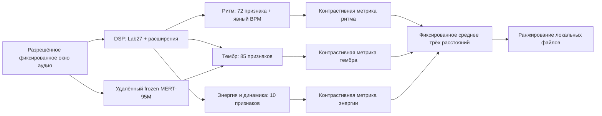

> Дополнение CPU rhythm pilot: [CPU_PILOT.md](CPU_PILOT.md).
> Прежние ограничения multi-aspect/MERT эксперимента ниже не являются
> предпосылками первого rhythm-only обучения. Его real-data gate сохранён отдельно.

# Архитектура и протокол v0.1

## Представление



`lab_audio.py` — точная копия проверенного 27-feature extractor PR #6. Его тестовая
история подтверждает техническое поведение, **не** точность слуховых оценок на новых
записях. Вместо переноса personal/session ranker используются только явные признаки.
Sample rate DSP = 16 kHz, FFT 2048, hop 512; стандартизация не обучается на каталоге.

| Компонент | Признаки и фиксированные шкалы |
|---|---|
| Ритм, 72 | beat regularity; onset density / 10; шесть onset buckets / 2; 64 коэффициента нормированной автокорреляции onset envelope на лагах 64–2048 ms |
| Тембр, 85 | MFCC 1–19: среднее / 100, std / 50, delta mean / 20, delta std / 20; centroid / 8000, flatness, low-band ratio; шесть centroid buckets / 2 |
| Энергия, 10 | RMS dBFS / 60; variation / 3; p90–p10 RMS-dB / 40; crest dB / 40; шесть относительных energy buckets / 2 |

Векторы ограничены [-3,3] и делятся на 3. MFCC рассчитываются из 40-band mel power,
без нулевого коэффициента; это более богатое тембровое описание, чем только centroid
и flatness, но не полная модель восприятия инструментов. История атак, вариация и
дельты сохраняют часть временной информации. Нормализации громкости перед DSP нет:
абсолютная энергия и её изменения — самостоятельные признаки.

MERT работает с mono 24 kHz и **заморожен**: eval, requires_grad=False,
inference_mode. Последний hidden state: 768 mean + 768 std по времени; фиксированные
5 s блоки усредняются. Неполный хвост <5 s не входит в MERT, но входит в DSP; для
первого corpus выбрать окна, кратные 5 s. Выбор слоя фиксирован до test, не подбирается
по нему. На входе тембровой метрики — 85 DSP + 1536 MERT значений; каждому блоку
дан одинаковый исходный вклад через масштабирование. Никаких текстовых embeddings.

Ритмическая и энергетическая метрики не получают MERT: это сужает канал скрытого
жанрового сигнала. Тембровый encoder может содержать жанровые/производственные
корреляции, поэтому разделение ветвей не является доказательством disentanglement.
Artist, genre, path, title, Yandex/Yambda ID и реакции не являются численными входами.

## Baseline и собственная модель

Дистанция каждой метрики — взвешенная сумма квадратов разностей / 4.
Baseline использует равные веса координат. Модель учит softmax-веса каждой метрики,
то есть небольшую диагональную Mahalanobis-метрику. Всего **1703 скалярных веса**
(72 + 1621 + 10), а не fine-tuning энкодера. Это минимальный полноценный обучаемый
слой с независимыми losses; сложная нейросеть до достаточных данных не обоснована.

Ритмическая дистанция = 0.75 × feature distance + 0.25 × tempo distance. Пусть
`g = log2(max(BPMa,BPMb)/min(BPMa,BPMb))`; tempo distance =
`min(1, g, abs(g-1)+0.15)`. Half/double не приравниваются бесплатно. Если tempo
неизвестен, вклад 0.5; отсутствие оценки не означает точного совпадения. BPM —
неподтверждённая оценка, beat regularity — не размер и не метр. Overall — равное
среднее трёх компонент, без персональных весов.

Для каждого аспекта нужны отдельные `(anchor, positive, negative)`:
loss = `softplus((d(a,p)-d(a,n)+0.05)/0.1) + 0.01*mean(theta²)`.
Adam full-batch, 300 эпох, lr 0.1, начальные logits=0, ограничение logits [-2,2].
Градиенты используют **только train**. Нормализаторы, fusion, пороги, эпохи и слой
зафиксированы до test; validation служит диагностике. Изменение решения после
просмотра test требует нового внешнего test corpus, а не повторной отчётности на нём.

## Разметка без предпочтений

1. До ранжирования выбрать окна по одинаковому правилу и составить инвентарь прав.
2. Объединить артистические псевдонимы, коллаборации, альбомные версии, ремастеры и
   excerpts одной записи. Хеши обнаруживают точные дубли; одинаковые записи в других
   кодеках требуют отдельной проверки, один SHA-256 этого не решает.
3. Назначить train/validation/test целым группам до выбора троек. Любой artist ID
   или recording_group между splits отклоняется. Десять CC0 имеют `diagnostic`.
4. Два независимых проверяющих слушают слепые A/B/C в случайном порядке и отвечают
   отдельно: «ближе ритмический рисунок и пульс», «ближе тембровый состав и атаки»,
   «ближе уровень/изменение энергии». Отдельно отмечаются BPM и неоднозначность.
   «Не знаю», равенство и разногласие остаются неизвестными и не создают triplet.
5. После согласования сохранить source=`human_acoustic_comparison`, aspect,
   reviewer_ids (псевдонимы), agreement=`agreed`, evidence (приватная квитанция
   review) и cases. `labels.json` привязывается к SHA-256 canonical manifest.

Формат одной **схематической, не фактической** метки:

```json
{"aspect":"rhythm","anchor":"record-a","positive":"record-b","negative":"record-c",
 "source":"human_acoustic_comparison","reviewer_ids":["reviewer-1","reviewer-2"],
 "agreement":"agreed","evidence":"private-review-receipt-and-hash","cases":[]}
```

Подбор кандидатов может использовать BPM/DSP/инструментальные теги только как
screening. Он не создаёт правильный ответ. Жанр применяется лишь для стратификации
диагностических случаев после слухового подтверждения, никогда как rhythm label.
Случайный другой трек не считается отрицательным автоматически. Необработанный
экспорт Listening Study (особенно `next`) не принимается в качестве этой разметки.

## Независимые проверки качества

Метрика — artist-macro triplet accuracy отдельно для rhythm/timbre/energy; равная
дистанция даёт 0.5. Дополнительно отчёт содержит три обязательных среза:

| Срез | Проверка |
|---|---|
| `same_genre_different_rhythm` | Ритмически близкий кандидат должен обходить тот же жанр с другим рисунком |
| `different_genre_similar_rhythm` | Другой жанр не должен мешать совпадающему ритму |
| `same_tempo_different_instrumentation` | При одинаковом BPM тембровая метрика должна различать инструментовку |

Все три требуют реальных независимых review; синтетические сигналы проверяют
только работоспособность. Для BPM дополнительно запланированы MAE/MAPE и accuracy
с допуском ±4%, строгая и octave-tolerant версии. Проверенных BPM сейчас нет;
автоматически оценённый BPM нельзя использовать как собственный ground truth.
В v0.1 отчёт явно сохраняет эту проверку `NOT RUN`; scoring BPM annotations пока
не реализован. Полный catalogue Recall@K также не измеряется через триплеты.

Технический минимум для real train: >=100 размеченных записей, >=20 независимых
artist groups, >=100 triplets **на каждый** аспект. Это gate против демонстрационных
весов, не утверждение достаточной статистической мощности. План расширения — DATA.md.
До real train также резервируются >=20 записей / >=5 artist groups и >=50 reviewed
triplets на аспект отдельно в validation и test; gradients эти записи не используют.

Для заявления улучшения на test нужны >=50 triplets и >=5 anchor artist groups
на аспект, >=20 и >=5 групп в каждом обязательном срезе. Парный bootstrap по
связанным группам исполнителей и общих кандидатов (2000 повторов, seed 20261011) сравнивает frozen
baseline и learned на одних заданиях. Общие кандидаты объединяют блоки в один
cluster, поэтому финальный test должен использовать непересекающиеся группы
записей/артистов между блоками заданий. Множественные коллаборации также объединяются.
Нижняя граница 95% CI должна быть >0 по всем аспектам, >=0 в обязательных срезах.
Нет меток/покрытия — `NOT ESTABLISHED`; достаточные данные без превосходства — `FAIL`.
Синтетические данные никогда не выставляют improvement=`PASS`.

## Артефакты и пределы

Хранить отдельно: manifest + evidence snapshots, labels/review receipts, index,
frozen embeddings + snapshot receipt, model.json, validation/test.json, lock,
git SHA и среду запуска. В model.json входят версия/схема, веса, hyperparameters,
hash всех входов, encoder revision/license/pooling, train loss, train artists/groups.
Test metrics сохраняются отдельным файлом с hash модели; модель не переписывается.

MFCC усредняются и могут реагировать на высоту звука; окно не характеризует целую
песню. Темп имеет неоднозначности, абсолютная энергия зависит от мастеринга.
Диагональная метрика не учит взаимодействия признаков. Улучшение ни по одному
акустическому аспекту пока не установлено. Необходим реальный слепой holdout.
