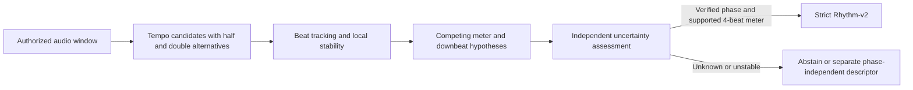

# Rhythm-v2 с неизвестными BPM, meter и downbeat: локальная применимость

Исходный HEAD: `d039093b09cf7a8f79d47238e855bbd911bb6068`.
Исследование выполнено 2026-10-14 только на прежних десяти локальных CC0 записях,
по прежним 15-секундным окнам. Это диагностика необученных DSP-гипотез.

**Итог: строгий Rhythm-v2 пока не готов к автоматическому поиску обычных песен.**
Два окна дают устойчивую внутреннюю гипотезу пульса; ни одно не имеет независимого
подтверждения ошибки фазы ≤1/16 beat и начала четырёхдольного такта. Все десять
отклонены на входе строгого extractor. Это измеренное покрытие текущего протокола,
а не доказательство, что алгоритмы downbeat в принципе не работают на этих песнях.

| Проверка | Результат |
|---|---|
| Исходный HEAD / чистая ветка / PR draft open unmerged | PASS |
| Доступность и SHA-256 всех 10 originals и evidence | PASS |
| Только утверждённые окна, по 15 с | PASS |
| Гипотеза BPM/пульса получена | 10/10 |
| Устойчивая автоматическая гипотеза, AUTO_CANDIDATE | 2/10: s03, o01 |
| ABSTAIN из-за внутренней нестабильности | 8/10 |
| VERIFIED по независимой фазе | 0/10 |
| Отказ строгого Rhythm-v2 gate | 10/10 |
| Строгое извлечение v2 | NOT RUN, 0 вызовов |
| Новое аудио / GPU / реальные fits / рецензенты | 0 / 0 / NOT RUN / не привлекались |

`AUTO_CANDIDATE` не означает допуск: это устойчивый, но непроверенный кандидат.
Поэтому число итоговых отказов extractor (10) отличается от числа записей со
статусом `ABSTAIN` (8). `phase_uncertainty_beats` везде **null**, не ноль.

## Данные и абсолютное время

Перед декодированием проверены все исходные audio/evidence hashes и неизменный
private manifest SHA-256
`24ce999d2b1175640ad4ae73e0d1c487a8fa80cc2ca5581819f391e0a29a0b1e`.
Manifest фиксирует локальную analysis-only область, training=false, remote=false.
Сам manifest и private paths не публикуются. Публичные source URLs, hashes,
названия и границы samples сохранены в новых численных артефактах.

Для девяти записей анализируется `[30,45)` секунд оригинала; для o03 начало
`3.6244671201814054` с, длительность также 15 с. Seek выполняется в
`round(start*sr)`, читается ровно `round(15*sr)` samples. Все reported timestamps
переведены обратно через фактическое `start_sample/sr`. Окна не расширялись.
По 32 мс на краях исключены из onset-анализа: без разрешённого pre-roll нельзя
отличить начальную атаку записи от transient, созданного обрезкой окна.

## Алгоритм и заранее заданные критерии

Повторно используется неизменный `rhythm_v2.spectral_attacks`. Новые модули —
[`rhythm_auto.py`](acoustic_similarity/rhythm_auto.py) и
[`rhythm_auto_audit.py`](scripts/rhythm_auto_audit.py); старые schemas, weights,
extractor, признаки, отчёты и workflow не меняются.

1. Четырёхполосные onset strengths переносятся на сетку 5 мс и сглаживаются
   Gaussian sigma=10 мс. Из центрированной огибающей вычисляется FFT linear
   autocorrelation с поправкой на число перекрывающихся samples.
   Положительные локальные пики периодов 40–260 BPM дают восемь кандидатов,
   с параболической интерполяцией lag. Первый — максимальный AC score, без prior
   «обычного музыкального темпа». Это периодичность, которая может оказаться
   половиной/четвертью пульса, размером группы или иной ритмической структурой.
   [SciPy 1.15.3 correlate](https://docs.scipy.org/doc/scipy-1.15.3/reference/generated/scipy.signal.correlate.html).
2. Для каждого периода фиксированный comb из 128 фаз выбирает наиболее
   поддержанный повторяющийся beat offset. Поиск выполняется по onset envelope,
   не по расстояниям между песнями. Регулярная сетка уточняется близкими атаками
   в пределах 1/8 beat; отсутствие такой атаки явно помечается. Это простой
   constant-tempo tracker с локальным уточнением, не полноценный tracker rubato.
3. Три неперекрывающиеся части по 5 с дают отдельные tempo ranks. Устойчивость
   требует одновременно: ≥8 событий с strength ≥20% window maximum, AC ≥0,1,
   ведущий BPM каждой части отличается от общего не больше чем на 2%, внутреннее
   расхождение beat phase ≤1/16 beat и onset-поддержка ≥60% grid beats.
   Эти пороги зафиксированы до получения real results, не калиброваны как
   вероятность правильного темпа и не заменяют независимую uncertainty.
4. Исследованы группы из 2/3/4/6 найденных долей: корреляция повторяющихся
   четырёхполосных accent vectors и все возможные rotations. Ни одна rotation
   не выбрана как downbeat. У одинаково акцентированных долей нет данных для
   выбора первого beat; повторяемость акцента сама по себе не задаёт метр.
5. Half/double alternatives сохраняются даже вне рабочего диапазона, с явным
   флагом. Дополнительно исследованы четыре частотные полосы, удаление нижней
   половины onset strengths, BPM ±1% и phase ±1/16 beat. Они не используются для
   выбора более удобного итогового результата и не вызывают strict extractor.

Уже имеющаяся старая оценка BPM использовала librosa. Её документация также
разделяет onset strength, tempo correlation и выбор совместимых beat peaks, а
tempo estimator по умолчанию использует prior. Совпадение результатов не было бы
независимой проверкой. Здесь использованы только установленные SciPy/NumPy/SoundFile;
дополнительные packages, модели и аудио не загружались.
[librosa 0.11 beat_track](https://librosa.org/doc/0.11.0/generated/librosa.beat.beat_track.html),
[tempo и prior](https://librosa.org/doc/0.11.0/generated/librosa.feature.tempo.html).

## Результаты по десяти записям

Время в таблице — секунды **оригинального файла**, не локального crop.
`B₀ / P / N` — origin регулярной beat-гипотезы, номинальный период и число долей.
Уточнённые фактические candidates могут отклоняться от этой сетки; все их времена
сохранены в per-track JSON. `DB4` — первые четыре **альтернативных** начала группы
из четырёх долей; далее каждая гипотеза берёт каждый четвёртый beat. Это не
утверждение о размере 4/4. В JSON также есть все rotations групп 2/3/6.

| ID | Название | Estimated BPM | Half / double BPM | B₀ / P / N | DB4: начальные альтернативы, с | Статус | Независимая проверка | Причина недопуска v2 |
|---|---|---:|---|---|---|---|---|---|
| s01 | Jazz | 44.98 | 22.49* / 89.96 | 30.636 / 1.3339 / 11 | 30.675, 32.010, 33.340, 34.674 | ABSTAIN | нет | tempo нестабилен; phase нестабильна; downbeat/точность не подтверждены |
| s02 | (Basically not) Fusion Jazz | 176.06 | 88.03 / 352.12* | 30.176 / 0.3408 / 44 | 30.185, 30.517, 30.875, 31.209 | ABSTAIN | нет | tempo нестабилен; phase нестабильна; downbeat/точность не подтверждены |
| s03 | Courtroom | 69.88 | 34.94* / 139.76 | 30.027 / 0.8586 / 18 | 30.057, 30.875, 31.732, 32.586 | AUTO_CANDIDATE | нет | downbeat/точность не подтверждены |
| s04 | Kingdom of a Million Elephants under a White Parasol | 46.67 | 23.33* / 93.33 | 30.904 / 1.2857 / 11 | 30.871, 32.157, 33.443, 34.729 | ABSTAIN | нет | tempo нестабилен; downbeat/точность не подтверждены |
| o01 | Funked Up | 43.51 | 21.75* / 87.01 | 31.153 / 1.3791 / 11 | 31.138, 32.518, 33.897, 35.276 | AUTO_CANDIDATE | нет | downbeat/точность не подтверждены |
| o02 | Bossa Nova | 86.00 | 43.00 / 172.01 | 30.038 / 0.6976 / 22 | 30.038, 30.732, 31.436, 32.120 | ABSTAIN | только авторский тег 129 BPM; фаза — нет | tempo нестабилен; phase нестабильна; downbeat/точность не подтверждены |
| o03 | 8Bit Title Screen | 43.75 | 21.88* / 87.51 | 4.364 / 1.3713 / 11 | 4.322, 5.696, 7.065, 8.435 | ABSTAIN | нет | phase нестабильна; downbeat/точность не подтверждены |
| o04 | Fantasy Orchestral Theme | 125.53 | 62.77 / 251.06 | 30.067 / 0.4780 / 32 | 30.037, 30.536, 31.033, 31.505 | ABSTAIN | нет | tempo нестабилен; phase нестабильна; downbeat/точность не подтверждены |
| u01 | Epic Boss Battle | 180.10 | 90.05 / 360.21* | 30.331 / 0.3331 / 45 | 30.361, 30.663, 30.979, 31.330 | ABSTAIN | нет | tempo нестабилен; phase нестабильна; downbeat/точность не подтверждены |
| u02 | JRPG Theme | 246.51 | 123.26 / 493.03* | 30.040 / 0.2434 / 62 | 30.064, 30.260, 30.533, 30.777 | ABSTAIN | нет | tempo нестабилен; phase нестабильна; downbeat/точность не подтверждены |

`*` Альтернатива вне диапазона 40–260 BPM, сохранена только как гипотеза.

Общие причины недопуска: нет независимого downbeat/phase evidence (10/10) и
не разрешена неоднозначность meter/начала такта (10/10). Дополнительно ведущий
темп расходится между частями у 7/10 и внутренняя phase-гипотеза у 7/10.
Недостатка событий по заданному числовому порогу не было: от 23 до 294 сильных
кандидатов. Однако количество кандидатов не подтверждает музыкальный пульс.

При s03 три части дают 69,91 / 69,75 / 69,99 BPM, максимальное внутреннее phase
расхождение 1/32 beat. При o01 — 43,51 / 43,49 / 43,56 BPM и 1/128 beat.
Даже эти хорошие внутренние числа не отвечают, является ли найденный период
четвертью, половиной пульса или группой ударов, и не определяют первый beat такта.

## o02: Bossa Nova, 86 против авторского 129 BPM

В сохранённой проверенной HTML evidence есть авторский тег `129bpm`. Он является
внешним основанием для рассмотрения 129 BPM, но не содержит beat timestamps,
размер, точность tempo или downbeat. Для VERIFIED gate он недостаточен.

Без использования тега estimator выбрал **86,004 BPM**, AC=0,637. Следующий пик
**51,599 BPM**, AC=0,632, почти равнозначен. Затем 64,527 и 257,125 BPM.
Три части окна выбирают **51,659 / 86,180 / 51,728 BPM**; максимальное внутреннее
phase расхождение **0,3203 beat**. Удаление слабой половины уже найденных атак
меняет ведущий период на **51,597 BPM**. Полосы отдельно предпочитают примерно
64,57 / 51,57 / 51,60 / 86,00 BPM.

Заранее заданные диагностические probes, без смены результата estimator:

| Проверяемый BPM | AC score | Grid beats с атакой в ±1/16 beat | Доля onset strength возле beats |
|---:|---:|---:|---:|
| 86 | 0,636 | 21/22, 95,45% | 27,05% |
| 129 | 0,489 | 32/33, 96,97% | 34,04% |

86 составляет приблизительно **2/3 от 129**, это не стандартная half/double-time
пара. Несколько акцентных периодичностей/группировок — правдоподобное объяснение,
но без разметки мы не устанавливаем ни swing/метр, ни правильный beat unit.
Высокая onset-поддержка обеих сеток показывает, почему её нельзя считать accuracy.
Итог o02: **ABSTAIN**, uncertainty=null, strict v2 не запускался.

## Атаки, слабые события, инструменты и чувствительность

Всего повторно обнаружен **2651 raw candidate**, совпадающий с прошлым audit.
После исключения 19 краевых кандидатов осталось **2632**, из них **1864** выше
заданного 20%-порога. Суммарная spectral strength вблизи выбранных grid beats
составляет лишь примерно 14,3–36,7% в зависимости от записи; остальные атаки могут
быть offbeat, подразделениями, другими инструментами либо ложными срабатываниями.
Без независимых меток эти случаи не разделены.

Второй, необученный energy-rise detector даёт **580 flux-кандидатов** без energy
candidate в ±20 мс и **646 energy-кандидатов** без flux candidate. Это расхождение
детекторов, **не precision/recall**, не 580 доказанных ошибок и не 646 пропусков.
Например s04: 149 interior flux против 283 energy candidates; 151 energy event
не имеет близкого flux-кандидата. Причину на waveform без onset labels не доказать.

Удаление нижней половины strengths меняет ведущий BPM у s01 с 44,98 на 90,00,
у o03 с 43,75 на 116,72, у o02 с 86,00 на 51,60. Различные спектральные полосы
также часто выбирают разные periods. Это измеренная чувствительность к составу
событий; гипотеза о причинном вкладе конкретных инструментов остаётся непроверенной,
поскольку stems и инструментальная разметка отсутствуют.

Для o02 изменение BPM на ±1% снижает grid support с 95,45% до 68,18% / 63,64%.
Для u02 с 74,19% до 55,74% / 57,14%. Изменение phase на +1/16 beat у o01 оставляет
100% grid support, но снижает долю соседней onset strength с 22,81% до 11,77%.
Такая плотность событий может создавать убедительную, но неправильную сетку.
Здесь сравниваются диагностические величины, не векторы/расстояния Rhythm-v2.

Mono energy / mean channel energy составляет около 0,546 и 0,555 у u01/u02.
Это наблюдаемая потеря энергии при stereo averaging; причинная связь с ошибками
ритма не установлена. У u01 ведущая AC всего 0,104; у u02 три разных periods имеют
почти одинаковую AC около 0,201. Уверенно назвать основной пульс нельзя.

Synthetic tests проверяют известный 120 BPM pulse, абсолютные timestamps,
смену темпа, пустые/редкие события, исключение краёв, невыбор самого сильного
акцента как downbeat и неизменный отказ VERIFIED gate без независимой фазы.
В искусственной смеси drum impulses и 700 Hz melodic transients детектор
включает также тональные атаки: он не является drum classifier. Это проверка
механики на известном сигнале, а не оценка качества распознавания музыки.

## Достаточны ли 15 секунд

В текущих гипотезах окно содержит 11–62 beats, то есть 2–15 полных четырёхдольных
групп. При медленной выбранной периодичности наблюдений мало. При высокой их
больше, но стабильный downbeat всё равно не подтверждён. У s04 repeat-correlation
четырёхдольной группы 0,943 при всего двух полных группах; у o03 для группы 6
получено 0,679 при одной полной группе. Такие числа не разрешают метрическую фазу.

15 секунд могут содержать достаточно материала для кандидатов, но эти десять
окон **не дали основания подтвердить downbeat с требуемой точностью**. Это не
универсальный запрет: явно размеченный фрагмент может быть достаточным. Увеличение
длины само по себе тоже не устраняет rotational symmetry и неоднозначность unit.
Даже при известном origin tempo error 0,25 BPM на протяжении 15 с накапливает
1/16 beat drift; внутренний допуск 2% для устойчивости не является этим bound.

## Минимальный дальнейший pipeline



Текущая реализация покрывает диагностические B/C и перечисление гипотез D.
Для автоматического допуска необходимы независимо проверенные beat/downbeat
данные и калибровка ошибок на полных аранжировках: tempo octave errors, bar offset,
coverage отказов, error по всему используемому такту. Доверие не следует выводить
из самосогласованности того же onset detector. При нынешнем контракте нет оснований
автоматически превращать эти кандидаты в VERIFIED. Большой encoder и новые веса
в этой работе не создавались и не обучались.

Практичный резерв для первого автоматического поиска — отдельный небольшой
**фазонезависимый** descriptor: многополосная onset autocorrelation в секундах,
распределение межсобытийных интервалов и несколько tempo hypotheses. Он не требует
начала такта, но теряет порядок акцентов и может путать разные drum patterns.
Нормализацию и uniform distance следует зафиксировать до оценки; сравнивать
с независимыми человеческими rhythm labels, включая «не уверен/оба/ни один».
Это предложение, не внедрённая модель. Не выбирать удобную фазу по song distances
и не передавать её в строгий v2 с выдуманной uncertainty=0.

Минимум для следующего этапа поиска: право на локальный корпус, такой честный
fallback/abstention контракт, независимые rhythm labels, раздельные authors/records
в evaluation и отчёт coverage вместе с accuracy. Сначала следует подтвердить
полезность необученного представления. Ни новый корпус, ни reviewers, ни обучение
в этом задании не запускались.

## Ресурсы, артефакты и воспроизведение

Реальный audit: **10,031993 CPU s** с импортами, **9,524315 s wall** после импортов,
peak RSS **346,004 MiB**, два вычислительных потока. Hard CPU limit 540 s,
hard virtual-memory cap 1024 MiB (строже RSS). Численные артефакты с synthetic
receipt и delivery hashes: **518 233 bytes**, меньше 2 MiB.
Расход локальных synthetic checks отдельно записан в `synthetic-checks.json`;
измеренная сумма audit и этих проверок меньше 15 CPU s. Preflight/hash/report IO
не входит в process CPU audit; оно не требует DSP, обучения или скачивания.
Новые аудиозагрузки **0 bytes**, сеть внутри audit запрещена Python audit hook.
GitHub/docs/обычный CI — отдельный инфраструктурный трафик, не нулевой.

[`validation/rhythm-auto-applicability-v1/`](validation/rhythm-auto-applicability-v1/)
содержит policy/source hashes до real analysis, per-track timestamps, alternatives,
meter rotations, reasons, sensitivity, summary, resources и два hash manifests.
Raw WAV/MP3/OGG и private paths не публикуются. `hashes.json` покрывает исходный
audit; `delivery-hashes.json` дополнительно покрывает synthetic receipt.

В существующем окружении с locked dependencies:

```sh
OPENBLAS_NUM_THREADS=2 OMP_NUM_THREADS=2 NUMBA_NUM_THREADS=2 PYTHONPATH=. \
  python scripts/rhythm_auto_audit.py --manifest "$LOCAL_APPROVED_MANIFEST" \
  --out /tmp/rhythm-auto-new
PYTHONPATH=.:tests python -m unittest test_rhythm_auto -v
```

Output create-only. При отсутствии локальных originals/evidence либо несовпадении
hashes создаётся `status.json` с BLOCKED, без fallback/download. Все восемь новых
tests используют synthetic arrays; новые реальные оценки не запускаются в CI.
Итоговый exact-head ML CI и статус открытого draft PR фиксируются в PR #10.
