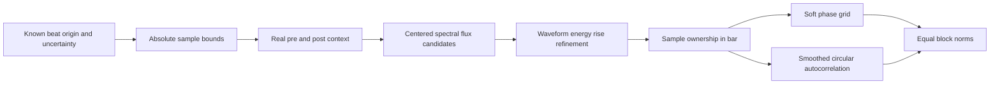

# Rhythm v2: временное выравнивание и границы доказательств

Работа начата от `6f0973fd4313913a1ab1f3e292fd7066f410287c`, 2026-10-14.
Добавлен отдельный **необученный** extractor
[`rhythm_v2.py`](acoustic_similarity/rhythm_v2.py), схема
`audio-attacks-softphase16-circularac64-equalblocks.v2`.
Старые `rhythm.py`, схемы, веса, результаты и training workflow не меняются.
Drummer6/drummer8 не использовались для выбора параметров, архитектуры или оценки v2.

Исправления временной обработки подтверждены на контролируемых сигналах.
**Превосходство v2 на реальных данных не установлено:** исходных GMD WAV локально
нет; из сохранённых 128 координат невозможно восстановить потерянные атаки.
Полное сравнение v1 uniform с повторно извлечённым v2 uniform — **NOT RUN**.
Реальное обучение, новые аудиозагрузки, публикация аудио — **NOT RUN**.

## Подтверждённые свойства и дефекты v1

Проверены `midi_events`, `midi_target`, `rhythm_features`, slicing в `run`/`search`,
а также аналогичный slicing исторического cap2. MIDI ticks переводятся в beats
делением на ticks-per-beat; tempo и 4/4 сверяются с metadata. Target — бинарная
сетка 9 drum families × 16 фаз. Аудио проходит native samples → mono → 16 kHz →
Hann STFT 512 samples / hop 128 → положительная разность magnitudes → 4 bands.

1. **Начальная атака действительно может полностью исчезнуть.**
   `diff(..., prepend=magnitude[:, :1])` делает первый flux-frame нулевым.
   Для одиночного импульса в sample 0 последующие magnitude только уменьшаются:
   положительного flux нет вообще. На 16 kHz то же подтверждено для samples 1 и
   64 (4 мс); sample 128 уже обнаруживается. Норма flux-блока v1: `0, 0, 0, 2`;
   v2 обнаруживает каждый заданный sample. Это воспроизводимый дефект, но не
   доказательство потери каждой первой ноты в GMD: у реального звука есть огибающая.

2. **Границы соседних окон могут отличаться на sample.**
   v1 независимо округляет `start_beat*60/bpm*sr` и длительность `4*60/bpm*sr`.
   При sr=8000, BPM=41, start_beat=4 конец получается 93658, а абсолютное начало
   следующего такта — 93659. Это разрыв 0,125 мс. В других комбинациях возможно
   перекрытие. Данный масштаб сам по себе не объясняет историческую точность.

3. **Центр STFT frame не равен моменту удара.**
   SciPy расширяет края, чтобы центр первого окна совпадал с первым sample;
   временные координаты относятся к сегментам. У импульса в 0,500 с максимум v1
   flux приходится на frame center 0,496 с. Разность соседних Hann-окон измеряет
   рост энергии окна, поэтому простое присваивание center-time атаке смещает фазу.
   Это не универсальная поправка −4 мс для всех инструментов.
   [Контракт SciPy STFT 1.15.3](https://docs.scipy.org/doc/scipy-1.15.3/reference/generated/scipy.signal.stft.html).

4. **Фаза предполагается известной, но не проверяется как отдельная величина.**
   GMD slicing считает нулевой beat равным нулю аудиофайла. `search` проверяет
   hash исходного GMD и BPM, затем берёт второй такт от того же предполагаемого
   origin. Это не поиск по произвольному файлу, однако контракт всё равно не
   выражает uncertainty/origin и не проверяет фактическую задержку MIDI→audio.
   Наличие такой задержки именно в доступном GMD наборе без WAV **не установлено**.

5. **Масштабы двух блоков различаются.**
   Каждая из четырёх flux-полос нормируется отдельно: полный flux norm равен 2.
   AC делится только на lag-zero, и его общая норма остаётся переменной.
   В реальном cache train AC norm: 0,315–1,007, mean 0,575;
   validation: 0,259–0,971, mean 0,544. Равные 128 весов поэтому не означают равную
   норму блоков. Это не доказывает, что именно AC следует всегда усиливать.

Жёсткое `rint(frame_time*bpm/60*4)%16` относит каждый frame целиком к одной фазе,
а `max` теряет количество атак внутри ячейки. MIDI `round` также использует
ties-to-even и circular wrap: событие у конца такта может попасть в ячейку 0,
хотя принадлежит этому же полуоткрытому окну. Это свойства существующей схемы,
а не основание менять исторические labels. Из-за распределённого по frames flux
они не означают обязательного скачка всего вектора при каждом сдвиге на sample.

## Почему audio и MIDI могут расходиться

MIDI target различает девять семейств, включая одновременно сыгранные ноты, и
игнорирует velocity. Четыре широкие спектральные полосы не распознают инструмент:
один удар занимает несколько полос, разные барабаны могут иметь близкие спектры,
а amplitude/envelope меняют flux. Нормирование слабой полосы также может усиливать
её шум. AC описывает интервалы/периодичность, но не принадлежность нот семействам.

На train найдено **61**, на validation **65** пар тактов одного drummer/BPM с
одинаковой бинарной временной occupancy, но разными 9×16 MIDI targets. Это
подтверждает необходимость различать «когда звучит» и «что звучит»; это не счётчик
одинаковых аудиовекторов и не измерение ошибок конкретных моделей.

Средняя корреляция суммарной audio phase mass с количеством MIDI families в фазе
без сдвига: train **0,648**, validation **0,564**. Лучший circular shift равен нулю
в **103/140** и **56/84** тактах соответственно. Выбор лучшего shift — только
диагностическая верхняя оценка: периодические рисунки, тембр и неоднозначные пики
дают несколько объяснений. Сдвиги не применялись и alignment по ним не настраивался.
Причины прежнего ухудшения cap2 таким анализом не доказаны.

## Что делает отдельная v2



- Оба конца вычисляются в абсолютных samples и округляются один раз. Владение
  атакой задаётся `[begin, end)`, конец соседнего такта совпадает с его началом.
  Ошибка округления каждого endpoint не больше 0,5 native sample.
- Из записи берётся до 32 мс настоящего контекста по обе стороны окна. Zero
  extension используется только на краях переданного аудио. Атаки вне такта
  фильтруются **после** детекции, поэтому обрезка не создаёт новый onset из хвоста.
- Native sr сохраняется; окно Hann 32 мс, hop около 2 мс. Flux сравнивается с
  нулевым предшествующим frame. Candidate peaks имеют prominence 5% от максимума
  и separation 32 мс. Это фиксированные инженерные параметры, не learned weights.
  [Семантика prominence/distance](https://docs.scipy.org/doc/scipy-1.15.3/reference/generated/scipy.signal.find_peaks.html).
- Центр candidate корректируется геометрией rising Hann derivative
  `(window/4-hop/2)/sr`, затем уточняется по максимуму положительного изменения
  причинной 2-мс waveform-energy в пределах ±window/4. Фаза считается по native
  sample этого события, а не по STFT timestamp. Для мягкой атаки это оценка,
  не гарантированное физическое начало звука.
- Flux strength линейно распределяется между соседними circular phase bins;
  события суммируются. В AC используется 256-bin onset grid и фиксированное
  треугольное сглаживание с radius 1/16 beat; сохраняются 64 лага 1/32…2 beats
  уникальной половины circular autocorrelation четырёхдольного такта.
- Оба 64-мерных блока получают L2 norm `1/sqrt(2)` при ненулевом сигнале.
  Это фиксированный бюджет квадратов норм 50:50, а не гарантия равных вкладов в
  каждую парную distance. Нулевая часть остаётся нулевой. v2 uniform означает
  обычное среднее квадратов разностей всех 128 новых координат.
- Нужны явные `beat_zero_seconds`, `start_beat`, `phase_uncertainty_beats`, BPM
  40…260 и native sr 8…96 kHz. Unknown/NaN phase, неполный такт, nonfinite/silent
  audio и uncertainty больше **1/16 beat** отклоняются. Неопределённость должна
  покрывать весь такт, включая накопленную ошибку BPM. Ноль uncertainty — обещание
  вызывающей стороны, не автоматическая проверка точности разметки.

Схема несовместима с v1, несмотря на те же 128 координат. Старый CLI, model loader,
weights и production не переключены. Входные массивы не изменяются; MIDI hits в
extractor не передаются. Новые зависимости не добавлены.

## Контрольные сигналы и ограниченная jitter-устойчивость

[`test_rhythm_v2.py`](tests/test_rhythm_v2.py) создаёт сигналы программно, без
скачивания и без публикации WAV. Проверены:

- импульсы на известных native samples: 8/16/44,1/48/96 kHz × BPM 60/123/200/260
  × два соседних такта; совпали все ожидаемые samples, без пропусков и дублей;
- каждый из 16 sixteenth bins, включая phase 0; событие на конце исключается;
- реальный pre-roll, абсолютные endpoints для BPM 40…260, четыре sample rates;
- затухающие sinusoids 60/300/1200/5000 Hz, четыре удара с amplitudes 1/0,2/0,5/1:
  каждый найден один раз, ошибка начала в пределах 4 мс;
- общий shift ±1/5/10 мс и независимые разнонаправленные shifts, gain ×0,2,
  soft assignment возле половины ячейки, отказ при неизвестной фазе.

Для четырёх импульсов в beats `[0.5, 1.25, 2.25, 3.5]`, с independent jitter
`[-10,+10,-10,+10]` мс получены следующие L2-изменения v2. Оба сравниваемых
полных вектора имеют норму 1; предел 0,65 в тесте относится только к этому fixture.

| BPM | Flux L2 | AC L2 | Полный L2 |
|---:|---:|---:|---:|
| 60 | 0,0294 | 0,1624 | 0,1651 |
| 120 | 0,0613 | 0,3165 | 0,3224 |
| 200 | 0,1078 | 0,5046 | 0,5160 |
| 260 | 0,1457 | 0,6164 | 0,6334 |

Это **не инвариантность** и не универсальная граница: в быстром темпе AC остаётся
чувствительным. Удар, пересекающий реальную границу такта, меняет владельца.
Очень слабые атаки могут не пройти prominence; flam с интервалом 10 мс заведомо
вне разрешения детектора и в regression test объединяется. Полнота обнаружения
полифонии, мягких атак и разных velocity на настоящей музыке не установлена.
Первые synthetic варианты AC и peak spacing были исправлены по этим fixtures
до просмотра результатов train/validation; поиска по раскрытым tests не было.

## Реальные train/validation: что удалось измерить

Источник: неизменный `validation/groove-cpu-v1/artifacts.zip`, SHA-256
`72a1f4505afcc095d3ffaddd3cdc354cc1718c08861313fd91bfb6788b7fc79e`.
Сразу после чтения JSON оставлены только train/validation. Анализ запрещает
передавать ему test rows/triplets; исходные MIDI labels и состав comparisons не меняются.

| Split | Bars / originals / components | Triplets | v1 uniform: верно / ошибки / ничьи | Accuracy | Настоящий v2 uniform |
|---|---|---:|---|---:|---|
| Train | 140 / 36 / 12 | 332 | 239 / 93 / 0 | 71,99% | NOT RUN: нет WAV |
| Validation drummer7 | 84 / 21 / 7 | 247 | 227 / 20 / 0 | 91,90% | NOT RUN: нет WAV |

Отдельный **cache-only probe** применяет только `equal_blocks` к старым векторам.
Он не меняет timestamps, не возвращает утраченную первую атаку и не превращает
старую линейную AC в новую circular AC. **Эти числа нельзя подписывать «v2».**

| Split | Cache equal-block uniform: верно / ошибки / ничьи | Accuracy | Изменение к v1 | Исправлено / испорчено |
|---|---|---:|---:|---:|
| Train | 265 / 67 / 0 | 79,82% | +7,83 п.п. | 37 / 11 |
| Validation | 218 / 29 / 0 | 88,26% | −3,64 п.п. | 3 / 12 |

По связанным компонентам train: 5 улучшились, 4 ухудшились, 3 без изменения.
Самый большой прирост — `drummer5/session2/19`: 2/32 → 22/32; ухудшения включают
`drummer1/eval_session/4`: 28/32 → 26/32 и `drummer9/session1/15`: 28/28 → 26/28.
Validation: 1 улучшилась, 3 ухудшились, 3 без изменения. `eval_session/2`:
28/36 → 30/36; `session1/22`: 36/40 → 30/40; `session2/46`: 28/32 → 24/32;
`session3/48`: 38/38 → 37/38. Остальные без изменения. Полный список — в JSON.
Компонента именуется одним её оригиналом; это не отдельная оценка только этого
оригинала. Triplets коррелированы, validation содержит одного drummer.

Нормализация дала пользу на train и вред на validation. Это противоречит
утверждению о доказанной пользе простой балансировки; после просмотра результатов
коэффициент 50:50, thresholds и схема v2 не перенастраивались.

## Реальные локальные waveform diagnostics

Повторно проверены права и hashes ранее разрешённых 10 CC0 originals из трёх
авторских групп. Прочитаны только утверждённые 15-секундные окна: **150 с** аудио.
Получено **2651 кандидатов** атак; это не 2651 подтверждённых ударов. Разница
refined-time и center-time в отдельных файлах имеет среднее 5,02–7,05 мс,
общий диапазон около −1…15,01 мс. Здесь нет разметки, позволяющей назвать refinement
более точным или посчитать precision/recall. Из-за неизвестных bar origins и
tempo uncertainty фазовые v2-векторы для этих записей не создавались.

Локальный audit: wall **10,587955 с**, process CPU **10,266872 с**, peak RSS
**331,695 MiB**, два заданных вычислительных потока. Research download **0 bytes**,
real fits **0**, held-out evaluations **0**. Это ресурсный отчёт процесса audit,
не всей сессии/CI: чтение документации, GitHub, checkout и установка Python/packages
в обычном CI являются отдельным ненулевым инфраструктурным трафиком.

## Воспроизведение и сохранённые доказательства

[`validation/rhythm-v2-diagnostics-v1/`](validation/rhythm-v2-diagnostics-v1/):
`synthetic.json`, `cached-development.json`, `local-waveforms.json`, `resources.json`,
`hashes.json`, `provenance.json`. Только численные summaries, публичные source URLs,
attribution и hashes; исходного или производного аудио и частных путей нет.
Точные fixture positions и генераторы находятся в tests/script.

В окружении с прежними locked dependencies:

```sh
OPENBLAS_NUM_THREADS=2 OMP_NUM_THREADS=2 NUMBA_NUM_THREADS=2 PYTHONPATH=. \
  python scripts/rhythm_v2_audit.py --out /tmp/rhythm-v2-audit-new
PYTHONPATH=.:tests python -m unittest test_rhythm_v2 test_rhythm_v2_audit test_diagnostics -v
```

Для локального waveform этапа нужно явно передать `--local-manifest` с уже
проверенными локальными файлами; без него этап пропускается. Output create-only,
socket audit запрещает сеть. Старый unit test автоматически повторял fit на
реальных 332 train rows: он заменён synthetic numerical regression; archive/model
hash checks сохранены. Реальные fits в этом этапе и новом CI не запускаются.

Полное сравнение re-extracted v1/v2 требует разрешённых оригинальных train/validation
WAV с проверкой MIDI/audio offset и независимой разметкой начала такта. Затем нужно
зафиксировать extraction failures/coverage и сравнивать обе модели на одних
допущенных comparisons, не удаляя ошибки по результату ранжирования. До этого
обучать v2 преждевременно. Новый learned этап требует отдельной авторизации,
версии dataset/model, заранее замороженных критериев и нового нераскрытого holdout.
Drummer6/drummer8 для этого больше не подходят.

Минимальный следующий опыт на полных аранжировках описан отдельно:
[`RHYTHM_V2_FUTURE_EXPERIMENT.md`](RHYTHM_V2_FUTURE_EXPERIMENT.md).
